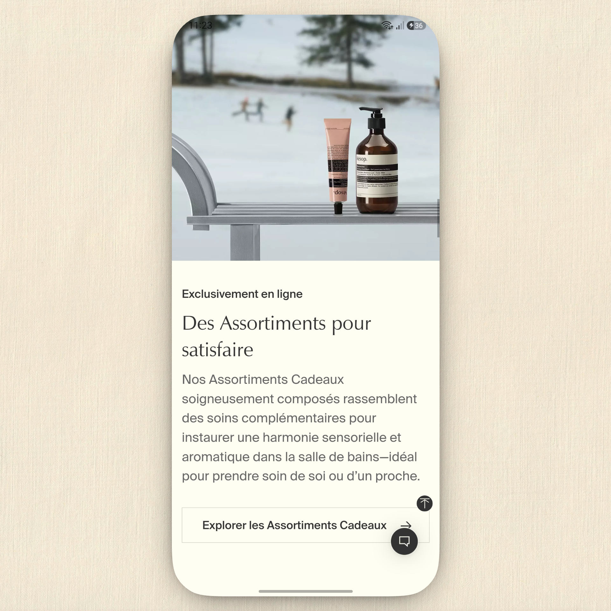
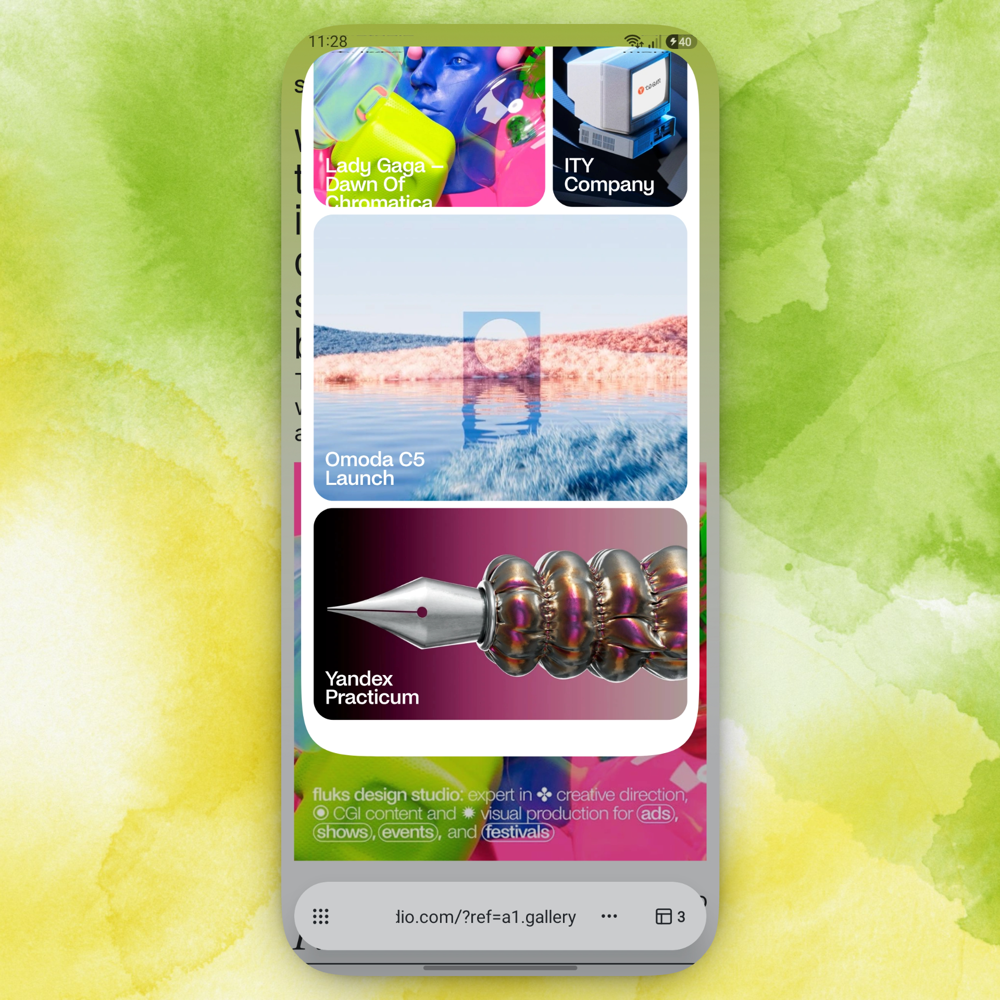

# Rezen Browser

Rezen Browser is a mobile-first browser and productivity app built with Expo and React Native. It is currently in active alpha, so expect iteration, rough edges, and rapid changes as the browser experience and product direction evolve.

This project is open source under the Apache License 2.0. Contributions, bug reports, and design feedback are welcome.

## Preview

<p align="center">
  
  
</p>

## Project status

- Status: Alpha
- License: Apache-2.0
- Stack: Expo, React Native, Expo Router, HeroUI Native

## Getting started

### Prerequisites

- Node.js 20+
- npm or Bun
- iOS simulator or Android emulator, or a physical device for native testing

### Install dependencies

```bash
npm install
```

### Run locally

```bash
npx expo start
```

Then use the Expo dev tools to open the app in:

- a simulator/emulator
- a development build
- Expo Go for quick smoke tests
- the web preview when needed

## Browser architecture

The app uses Expo Router for screen navigation and keeps document/browser UI inside the browser-specific components under `src/components/browser`.

Key areas:

- `src/app` — route screens and app entry points
- `src/components/browser` — browser chrome, tab previews, search sheet, new-tab experience
- `src/components/onboarding` — intro screen and mesh animation
- `src/hooks` and `src/constants` — shared app logic and theme configuration

## Contributing

We welcome contributors who want to improve the browser experience, polish onboarding, or add new product ideas.

1. Fork the repository and create a feature branch.
2. Install dependencies with `npm install`.
3. Work in the relevant area of the app.
4. Run linting before opening a PR:

   ```bash
   npx expo lint
   ```

5. Open a pull request with a clear description of the change and any screenshots or demos if relevant.

## Development notes

- Prefer mobile-first patterns and cross-platform compatibility.
- Match the existing design language: soft mesh gradients, translucent surfaces, and clear app interactions.
- Use Expo Router patterns for new screens rather than ad-hoc navigation.
- If you add native functionality, check the relevant Expo docs and keep the app compatible with the current SDK.

## License

This project is licensed under the Apache License 2.0. See the [LICENSE](LICENSE) file for the full terms.

## Resources

- [Expo](https://expo.dev)
- [Expo Router](https://docs.expo.dev/router/introduction)
- [React Native](https://reactnative.dev)
- [HeroUI Native](https://heroui.com)

## Support and feedback

If you find a bug, have a feature idea, or want to discuss the direction of the browser, open an issue or start a discussion in the repository.
